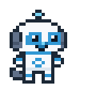
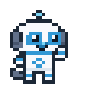
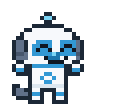

# pixel-sherpa-pet

Пиксельный чиби-маскот робопса Sherpa для Windows. Живёт над панелью задач: гуляет, моргает, машет лапой, засыпает, когда вы отошли. А ещё с ним можно **поговорить**: двойной щелчок, вопрос голосом, короткий ответ нейронки.

| Рад | Ходит | Привет |
| --- | --- | --- |
|  |  |  |

| Смотри | Ура | Спит |
| --- | --- | --- |
|  |  |  |

Видео с панели задач: [ходит](docs/demo/01-hodit.mp4), [привет](docs/demo/02-privet.mp4), [смотри](docs/demo/03-smotri.mp4), [ура](docs/demo/04-ura.mp4), [спит](docs/demo/05-spit.mp4).

## Что понадобится

- **Windows 10 или 11** (окно, звук и хранение ключа сделаны под Windows).
- **Python 3.11 или новее** с python.org. Проверено на 3.12. При установке отметьте «Add python.exe to PATH»; модуль Tk ставится по умолчанию.
- **Микрофон**. Берётся тот, что выбран в Windows по умолчанию.
- **Интернет** при установке (пакеты и модель речи, около 225 МБ) и при каждом вопросе (запрос к нейронке). Распознавание речи работает без интернета.
- **Ключ OpenRouter** для нейронки. Без него питомец гуляет, а голосовая справка не ответит. Как получить ключ, написано ниже.

## Установка

### Быстро (два файла)

1. Скачайте проект: на странице репозитория **Code → Download ZIP** и распакуйте в любую папку, либо `git clone https://github.com/Olleala2023/pixel-sherpa-pet.git`.
2. Дважды щёлкните **`Установить.bat`**. Он создаёт папку `.venv`, ставит в неё пакеты из `requirements.txt` и спрашивает, ставить ли локальную модель распознавания речи (GigaAM v3 e2e, около 225 МБ): `1` — да, `2` — пропустить. Модель кладётся в `brain/models/gigaam-v3-e2e/`. В конце нажмите любую клавишу; если что-то не вышло, причина написана в этом же окне.
3. Дважды щёлкните **`Запустить_Шерпу.bat`**. Пёс появится над панелью задач. Если нужен ярлык на рабочем столе, создайте его из этого bat-файла, значок — `sherpa.ico`.
4. Введите ключ OpenRouter (см. «Подключаем нейронку»).

### Вручную (PowerShell, из папки проекта)

```powershell
py -3 -m venv .venv
.venv\Scripts\python -m pip install -r requirements.txt
.venv\Scripts\python tools\download_model.py
.venv\Scripts\pythonw sherpa_pet.py
```

Повторный запуск не плодит копий: второй процесс видит, что питомец уже открыт, и сразу закрывается.

## Подключаем нейронку (OpenRouter)

Ответы даёт любая модель из каталога [OpenRouter](https://openrouter.ai/models), одним ключом.

1. Зарегистрируйтесь на [openrouter.ai](https://openrouter.ai) и, если выбранная модель платная, пополните баланс.
2. Создайте ключ на странице [openrouter.ai/keys](https://openrouter.ai/keys) и скопируйте его.
3. Правый щелчок по псу → **«Настройки нейронки…»** (или шестерёнка в окне справки). Вставьте ключ в поле «Ключ API» (Ctrl+V работает при любой раскладке).
4. В поле «Модель» напишите идентификатор модели с сайта в виде `автор/название`. Без изменений в конфиге стоит `deepseek/deepseek-v4-flash`.
5. Нажмите **«Проверить»**: бесплатный запрос к OpenRouter покажет, принят ли ключ и существует ли модель. Ничего при этом не сохраняется и вопросов нейронке не задаётся. Потом **«Сохранить»**.

Ключ можно задать и переменной окружения `OPENROUTER_API_KEY` (например, для запуска без окна настроек). Если ключ сохранён в окне, он важнее переменной.

Где лежит ключ: в диспетчере учётных данных Windows (запись «Sherpa brain»). В `brain/config.toml`, в базу и в лог он не попадает. В окне ключ целиком не показывается: видна только маска `…1234`, а в пустом поле серая подсказка «Ключ задан». Пустое поле при сохранении оставляет ключ как есть.

В окне «Настройки» внизу сводка расхода: за 7 дней, 30 дней и всё время, со ссылкой «Сбросить счётчик». Дневной лимит по умолчанию $0,50 (`daily_limit_usd` в конфиге): когда он израсходован, нейронка отвечает «Лимит на сегодня исчерпан» до следующего дня.

## Подключаем распознавание голоса

Речь распознаётся **на вашем компьютере**: аудио никуда не отправляется, в нейронку уходит только текст вопроса.

Используется модель **GigaAM v3 e2e** (русский язык, сразу с заглавными буквами и знаками препинания) через библиотеку `sherpa-onnx` и детектор пауз Silero VAD. Silero VAD уже лежит в проекте (`brain/models/silero_vad.onnx`), а саму модель речи скачивает `Установить.bat` (если вы ответили «1») или команда:

```powershell
.venv\Scripts\python tools\download_model.py
```

Файлы (`model.int8.onnx` около 225 МБ, `tokens.txt`, `LICENSE`) окажутся в `brain/models/gigaam-v3-e2e/`. Скрипт можно запускать повторно: готовые файлы он пропускает. Если сеть не пускает на Hugging Face, скачайте эти три файла вручную со страницы [csukuangfj/sherpa-onnx-nemo-ctc-punct-giga-am-v3-russian-2025-12-16](https://huggingface.co/csukuangfj/sherpa-onnx-nemo-ctc-punct-giga-am-v3-russian-2025-12-16/tree/main) и положите в ту же папку. Лицензия модели лежит рядом с ней.

Если модель лежит в другом месте, укажите пути в `brain/config.toml`, раздел `[gigaam]` (пути без диска считаются от папки `brain/`):

```toml
[gigaam]
model = "D:/models/giga/model.int8.onnx"
tokens = "D:/models/giga/tokens.txt"
num_threads = 4
```

Проверка: двойной щелчок по псу → микрофон (или пробел) → скажите фразу → ещё раз. Текст должен появиться в поле, его можно поправить, Enter отправляет вопрос. Если модели нет, окно скажет об этом прямым текстом и подскажет команду.

Модель начинает загружаться (около секунды), как только началась запись, и выгружается из памяти после 5 минут простоя. Самый долгий — первый вопрос после включения компьютера: «мозг» запускается около 10 секунд, но это тоже происходит, пока вы говорите.

Запись режется на куски по паузам в речи (пауза от 0,8 с, кусок не длиннее 20 с), и каждый кусок распознаётся сразу, ещё во время записи. Подобрать эти числа на своей записи с эталонным текстом можно скриптом `tools\tune_vad.py`.

## Как пользоваться

- **Левый щелчок** по псу: короткая реакция. Его можно перетащить мышью; отпущенный в воздухе, он падает и бонкает о панель.
- **Двойной щелчок**: сразу запись, над псом облачко «Слушаю». Пока вы говорите, в облачке появляется уже понятый текст: каждая фраза примерно через секунду после паузы в речи. Одиночный щелчок по псу: готово, к этому моменту почти всё уже распознано. Вопрос уходит нейронке, ответ пишется в облачке по мере генерации и сам гаснет через 8–45 секунд (пока мышь над облачком, не гаснет). Кнопки облачка: «Ещё» (следующий вопрос в той же теме), «Копировать», «В окне» (разговор переносится в окно справки). Через 10 минут тишины начинается новая тема.
- **Горячая клавиша** `Ctrl+Alt+Space` делает то же самое, не трогая мышь. Если её заняла другая программа, пёс берёт `Ctrl+Alt+Q`, потом `Win+Alt+S`; какая досталась, видно в первом пункте меню.
- **Окно справки** вместо облачка: снимите галочку «Отвечать облачком (без окна)». Тогда двойной щелчок открывает окно «Шерпа»: микрофон или пробел — начать и закончить запись, текст можно поправить, Enter отправляет. «Новая тема» забывает прошлые реплики, закрытие окна тоже.
- **Правый щелчок**: меню. Голосовой вопрос, история запросов, настройки нейронки, напоминания, перезапуск «мозга», проверка обновлений, галочки «Гулять по панели», «Звуки» и «Отвечать облачком», размер от 2× до 5× (текущий отмечен; по умолчанию 3×, при 4× и 5× углы сглаживаются, а 2× и 3× остаются пиксельными), выход. Размер и галочки пёс запоминает до следующего запуска (файл `sherpa-settings.json` в папке проекта; удалите его, чтобы вернуть всё как было).
- **История** (значок часов в окне справки): четыре карточки расхода (сегодня, 7 дней, 30 дней, всё время), таблица последних 50 запросов, двойной щелчок по строке открывает подробности. Сброс счётчика обнуляет только цифры, история остаётся.

Что умеет нейронка, кроме ответа:

- **Время и дата**: «какой сегодня день», «сколько времени».
- **Точный счёт**: «сколько будет 17 процентов от 2350» — считает калькулятором, а не «в уме».
- **Напоминания**: «напомни через 10 минут выключить чайник». В срок пёс подпрыгивает и показывает облачко со звуком. Список и отмена: меню → «Напоминания». Напоминания живут, пока Шерпа запущена; после перезапуска пропадают. До суток вперёд.
- **Буфер обмена**: «переведи то, что я скопировал», «что у меня в буфере». Текст из буфера (до 4000 знаков) уходит нейронке только когда вы сами о нём говорите.

Всё это выключается строкой `tools = false` в `brain/config.toml` (например, если выбранная модель не умеет вызывать инструменты).

Питомцем можно управлять из другого скрипта: пока он запущен, строка в файле `sherpa-state.txt` в корне проекта переключает позу (`idle`, `walk`, `wave`, `look`, `think`, `jump`, `sleep`). Пустой файл или его удаление возвращает обычную жизнь.

## Обновление

Меню пса → **«Проверить обновления»**. Если на GitHub есть новая версия, над псом появится облачко со списком изменений и кнопкой **«Обновить»**: пёс скачает её, при необходимости доставит пакеты и перезапустится сам вместе с «мозгом». Ещё пёс сам проверяет обновления через минуту после запуска, не чаще раза в сутки, и показывает облачко, только если есть что ставить.

Способ выбирается сам:

- **Установка через `git clone`**: `git pull`. Если в папке есть свои правки в файлах программы, свои неотправленные коммиты или другая ветка, пёс ничего не трогает и объясняет, что мешает.
- **Установка из Download ZIP**: пёс скачивает архив ровно той версии, что показал, и кладёт файлы программы поверх. Какая версия стоит, хранится в `.sherpa-version`. Первая проверка после установки из ZIP всегда предложит обновиться: версия ещё неизвестна.

В обоих случаях не трогаются ключ API, `brain/config.toml`, история и записи (`brain/data/`), модель речи и `.venv`. Файлы, удалённые из программы на GitHub, при обновлении из ZIP остаются в папке: они не мешают.

## Настройки в `brain/config.toml`

Файл создаётся при первом запуске. Менять можно в блокноте; ключ API в него не пишется. Изменения подхватываются после перезапуска «мозга» (см. ниже).

| Параметр | По умолчанию | Что делает |
| --- | --- | --- |
| `provider`, `model` | `openrouter`, `deepseek/deepseek-v4-flash` | Нейронка; удобнее менять в окне «Настройки» |
| `daily_limit_usd` | `0.5` | Дневной лимит расхода в долларах |
| `max_answer_tokens` | `1000` | Предел длины ответа |
| `max_dialog_pairs` | `6` | Сколько прошлых пар «вопрос-ответ» помнит диалог |
| `max_audio_s` | `60` | Самая длинная запись, секунды |
| `stt_idle_unload_s` | `300` | Через сколько секунд простоя модель речи выгружается |
| `brain_idle_exit_s` | `3600` | Через сколько секунд без запросов «мозг» завершается сам |
| `audio_keep` | `50` | Сколько последних записей хранить |
| `port` | `8765` | Порт «мозга» на 127.0.0.1 |
| `system_prompt` | про Шерпу | Характер: как нейронка отвечает. Удобнее менять в окне «Настройки», поле «Характер»; пустое поле возвращает стандартный |
| `tools` | `true` | Можно ли нейронке звать инструменты: время, счёт, напоминание, буфер обмена |
| `[gigaam]`, `[vad]` | см. файл | Модель речи и порог нарезки по паузам |

«Мозг» — отдельный процесс (`python -m brain`, сервис на 127.0.0.1). Питомец запускает его сам при первом вопросе. Чтобы он подхватил новый конфиг или код, выберите в меню пса **«Перезапустить мозг»**.

Что где хранится: `brain/data/brain.db` (история и расход), `brain/data/audio/` (последние записи), `brain/data/brain.log` (лог). Эти файлы только на вашем компьютере и в git не попадают.

## Если не работает

| Что видно | Что делать |
| --- | --- |
| «Нет модели распознавания речи» | Запустите `tools\download_model.py` (см. выше) |
| «Ключ не принят» или нет ответа | Окно «Настройки» → «Проверить». Проверьте ключ на [openrouter.ai/keys](https://openrouter.ai/keys) и баланс |
| Модель «не найдена» | Идентификатор должен совпадать с тем, что на openrouter.ai/models, вида `автор/название` |
| Мозг не отвечает | Откройте `brain/data/brain.log`. Если порт 8765 занят, поменяйте `port` в `config.toml` |
| Микрофон молчит | Выберите нужный микрофон устройством по умолчанию в «Параметры Windows → Звук → Ввод» и разрешите доступ приложениям к микрофону |
| `Установить.bat` пишет «Не найден Python» | Установите Python с python.org с галочкой «Add python.exe to PATH» и запустите bat заново |
| Дневной лимит исчерпан | Подождите следующего дня или увеличьте `daily_limit_usd` |
| Горячая клавиша не срабатывает | Посмотрите в меню, какая досталась. Если в первом пункте меню клавиши нет, все три заняты другими программами |
| Нейронка ругается на инструменты | Выбранная модель их не поддерживает: поставьте `tools = false` в `config.toml` и перезапустите мозг из меню |

## Что внутри

```text
sherpa_pet.py          точка входа питомца (на неё смотрят ярлыки)
Запустить_Шерпу.bat    запуск без консоли
Установить.bat         установка: .venv, пакеты, модель речи
requirements.txt       пакеты
sherpa.ico             значок
sherpa/                код приложения
  pet.py               окно питомца над панелью задач, меню, напоминания
  bubble.py            облачко над псом: запись, ответ, уведомления
  hotkey.py            глобальная горячая клавиша Windows
  updater.py           обновление с GitHub: git pull или архив ZIP
  voice.py             запись с микрофона, клиент «мозга»
  voice_ui.py          окна справки, истории и настроек
  markdown_view.py     Markdown в ответах (жирный, списки, код, ссылки)
  sprites.py           рисует самого пса (и собирает пакет картинок)
  smooth.py            увеличение со сглаженными углами для 4× и 5× (Scale2x и гладкие маски)
brain/                 «мозг»: распознавание, нейронка, история (FastAPI + SQLite)
  tools.py             инструменты нейронки: время, счёт, напоминание, буфер обмена
  models/              Silero VAD и (после установки) модель речи
assets/
  chibi-pack/          готовые кадры, GIF и Shimeji-спрайты
  sounds/              звуки падения и отскока
  telegram/            видеостикеры, эмодзи и статичные стикеры для Telegram (см. README там)
tests/                 автотесты «мозга» (pytest)
tools/                 скрипты для разработки (звуки, демо, скачивание модели, экспорт в Telegram)
docs/                  ТЗ голосовой справки, макеты окон, видео, эскизы
references/            чужие репозитории для сравнения (в git не входят)
```

Подробное описание протокола между питомцем и «мозгом»: [docs/голосовая-справка-ТЗ.md](docs/голосовая-справка-ТЗ.md).

### Для разработчиков

Все команды из корня проекта, внутри `.venv` (`.venv\Scripts\python`).

```powershell
python -m sherpa.sprites         # пересобрать кадры, GIF, Shimeji и sherpa.ico
python tools\make_sounds.py      # синтезировать звуки (нужен только numpy)
python tools\demo_krug.py        # проверить физику падения и звуки на простом кружке
python tools\spike.py путь.wav   # разовая проверка распознавания и нейронки
python -m brain                  # запустить «мозг» вручную
python tools\telegram_export.py  # стикеры и эмодзи для Telegram в assets/telegram/ (нужен ffmpeg)
python tools\tune_vad.py запись.m4a эталон.txt  # подбор паузы и предела куска для живого распознавания
python -m pip install pytest pytest-asyncio
python -m pytest                 # автотесты «мозга»: боевые база, конфиг, ключ и сеть не трогаются
```

Варианты звуков можно послушать в `assets/sounds/прослушать.html`, три пиксельных стиля — в `docs/design/собачка.html`.
