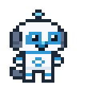
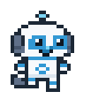
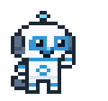
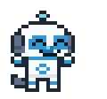
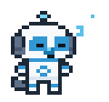

# pixel-sherpa-pet

Пиксельный чиби-маскот робопса Sherpa: спрайты, GIF и питомец для Windows, который живёт над панелью задач.

Гуляет вдоль панели, моргает, машет лапой, показывает экран чата, прыгает и засыпает, если компьютер какое-то время стоит без дела. Левый щелчок вызывает короткую реакцию, пса можно перетащить мышью, правый щелчок открывает меню.

## Как выглядит

Покадровые GIF собираются скриптом и сразу играют на странице репозитория:

| Рад | Ходит | Привет |
| --- | --- | --- |
|  |  |  |

| Смотри | Ура | Спит |
| --- | --- | --- |
|  |  |  |

Короткие записи с панели задач (пес вживую, не только GIF):

- [Ходит](docs/demo/01-hodit.mp4)
- [Привет](docs/demo/02-privet.mp4)
- [Смотри](docs/demo/03-smotri.mp4)
- [Ура](docs/demo/04-ura.mp4)
- [Спит](docs/demo/05-spit.mp4)

На GitHub ролик из ссылки открывается на своей странице. В теле README сами играют GIF.

## Запуск в Windows

Дважды щёлкните `Запустить_Шерпу.bat` или ярлык «Робопёс Шерпа» на рабочем столе.

Из папки проекта:

```bat
pyw -3 sherpa_pet.py
```

Повторный запуск не плодит копий: второй процесс видит, что питомец уже открыт, и сразу закрывается.

Правый щелчок по псу: поза, размер от 2× до 5×, прогулка вдоль панели, звуки, выход.

Если поднять пса и отпустить, он падает с ускорением, тихо бонкает о панель и чуть отскакивает. Звуки лежат в `sounds/sherpa_land.wav` и `sounds/sherpa_bounce.wav`, их собирает `make_sounds.py`. Все кандидаты можно послушать в `sounds/прослушать.html`, а физику и звуки проверить на простом кружке: `pyw -3 demo_krug.py`.

## Управление из другого скрипта

Пока питомец запущен, одна строка в файле `sherpa-state.txt` в корне проекта переключает позу:

`idle`, `walk`, `wave`, `look`, `think`, `jump`, `sleep`

Пустой файл или его удаление возвращает обычную жизнь: прогулка, паузы и сон после 90 секунд без мыши и клавиатуры.

## Что внутри

- `sherpa_pet.py` — окно без рамки поверх остальных, сидит на верхней кромке панели задач.
- `build_sherpa_pack.py` — заново собирает PNG, GIF, кадры Shimeji и `sherpa.ico`.
- `make_sounds.py` — синтезирует звуки (нужен numpy) и кладёт выбранные в `sounds/`.
- `sherpa-chibi-pack/` — готовый пакет: `frames/`, `gifs/`, `shimeji/img/shime1.png` … `shime46.png`.
- `собачка.html` — три пиксельных стиля в браузере, у чиби шесть настроений.
- `Запустить_Шерпу.bat`, `sherpa.ico`.

Нужны Python 3 и Pillow (`pip install pillow`). Окно питомца рисуется средствами Tk, отдельные библиотеки для него не нужны.

Пересобрать картинки:

```bat
py -3 build_sherpa_pack.py
```
